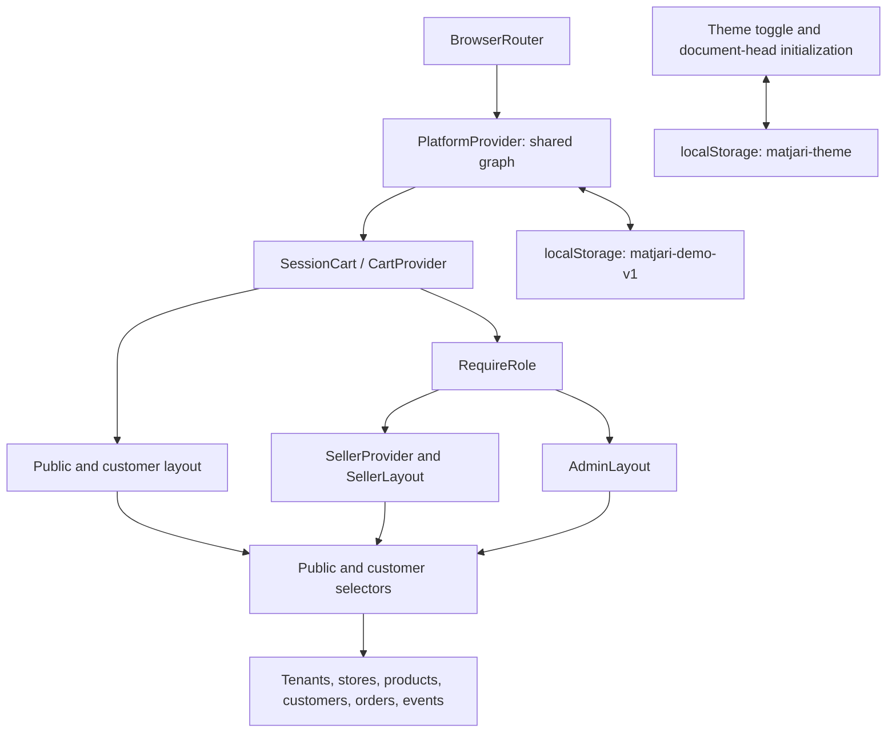

# Frontend architecture

[Documentation index](../README.md)

## Runtime and organization

The frontend is a JavaScript React 19 single-page application built by Vite 8. [main.jsx](../../apps/web/src/main.jsx) mounts the app under StrictMode. [App.jsx](../../apps/web/src/App.jsx) defines BrowserRouter, layouts, lazy-loaded pages and route guards. Vite uses its React plugin, the default `/` asset base and no API proxy.

## Source map

| Directory | Responsibility |
| --- | --- |
| `src/pages/` | Marketplace home, catalog, stores, product detail and cart; `Orders.jsx` is a legacy page no longer routed |
| `src/components/` | Shared marketplace header/footer, cards, empty/loading states and credits |
| `src/customer/` | Authentication, profile, checkout, confirmations, history and transaction model |
| `src/seller/` | Workspace layout/UI, scoped provider, dashboard, management and order pages |
| `src/admin/` | Workspace layout, parameterized admin pages, selectors and seed extension |
| `src/auth/` | Session validation, role policy, safe destinations and guards |
| `src/platform/` | Shared provider, context, persistence, public selectors, marketplace hook and demo toolbar |
| `src/context/` | Cart adapter and context |
| `src/data/` and `src/services/` | Base marketplace seed and catalog/cart helpers |
| `src/theme/` | Theme preference helpers and toggle |

## Routing and presentation

The public/customer `CustomerLayout` renders Header, a main outlet and Footer. Customer pages add their own `Frame`. Seller pages use SellerProvider and SellerLayout; admin pages use AdminLayout. `RequireRole` gates each protected branch, and `GuestOnly` handles login/register. A shared Suspense boundary supplies a loading skeleton. Route changes update document titles and manage heading focus. See [all routes](PAGES_AND_ROUTES.md).

## State and data logic

There is no Redux or remote query cache. PlatformProvider owns one React state graph. It seeds through `createDemo` → `adminSeed` → seller `seed` → the base marketplace data. IDs connect records rather than duplicating store or customer datasets.

`setData` supports functional updates. A ref holds the latest in-tab graph, so `transact` can apply a pure checkout result without using stale state. Successful checkout validates all items, creates orders and reduces inventory together. This is an in-memory transaction, without server or concurrent-tab guarantees.

SellerProvider exposes records and mutations scoped to the session tenant and selected store. CartProvider adapts the shared cart, enforces customer access and revalidates public availability/stock. SessionCart keys CartProvider by user ID to reset transient notices on identity changes. Forms, filters, pagination, dialogs and feedback use local component state.

Presentation pages call helpers in `services/catalog.js`, `seller/data.js`, `admin/data.js`, `customer/model.js` and `platform/selectors.js`. `publicStores` excludes suspended stores and suspended tenants; `publicProducts` also requires an active product. `useMarketplace` exposes those public views. `customerOrders` filters by ID; the customer model adds active-session ownership validation. Admin selectors aggregate across the whole graph. This separates reusable data rules from rendering, although some UI-specific filtering remains in pages.

## Persistence and recovery

[Persistence implementation](../../apps/web/src/platform/persistence.js) saves `{ version: 1, data }` under `matjari-demo-v1`. It includes records, session, cart and selected context. Loading validates relationships, unique IDs/slugs, statuses, amounts and quantities, then validates the session. Valid sessions restore synchronously before route rendering; carts are revalidated, and a seller's owned store selection is retained.

Invalid sessions become guests. Malformed, unsupported or invalid saved graphs remain untouched while a seed runs in memory with a recovery message. Storage failures also allow in-memory use. Confirmed Reset Demo Data replaces the saved graph with the seed and clears session/cart/context. Cancel keeps the graph. The independent `matjari-theme` preference survives reset and sign-out.

Storage is per browser origin and intended for one active tab. There is no server synchronization, authentication service or database integration. All local data remains inspectable and editable.
