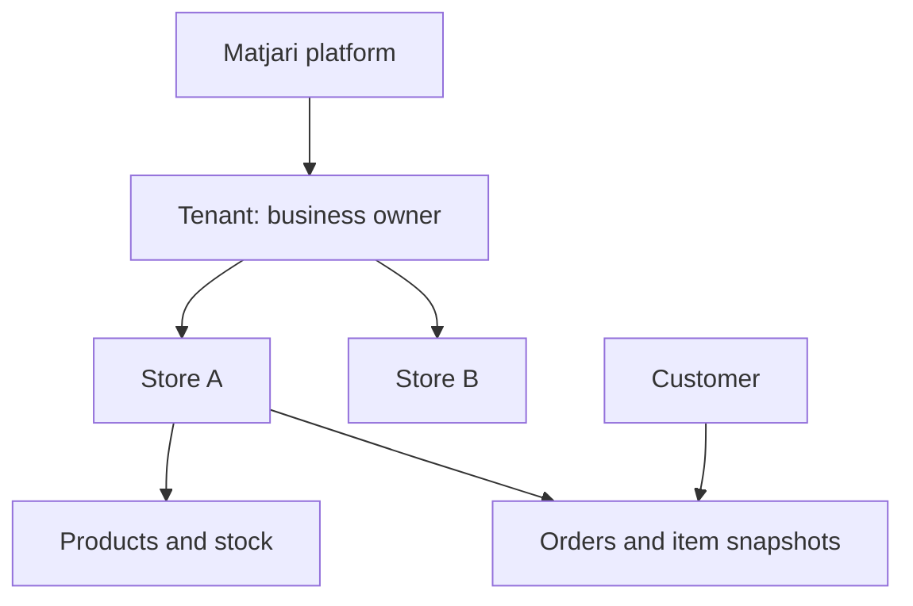

# Multi-tenant model

[Documentation index](../README.md)

A tenant represents an independent business within the shared platform. A tenant can own multiple stores. The frontend graph models these relationships with identifiers; it is not an implemented database schema.

## Actual demo ownership

| Tenant ID | Tenant name | Store IDs and public slugs |
| --- | --- | --- |
| `t1` | North Collective | `s1` Form & Function (`form-and-function`); `s2` The Everyday Edit (`the-everyday-edit`) |
| `t2` | Everyday Group | `s3` Nest Living (`nest-living`); `s5` Outside Supply (`outside-supply`) |
| `t3` | Olive & Co. | `s4` Olive Studio (`olive-studio`) |
| `t4` | Playground Trading | `s6` Little Wonders (`little-wonders`) |

The base seed is [data/marketplace.js](../../apps/web/src/data/marketplace.js); seller/admin seed helpers add inventory, orders, statuses and events. Products and orders carry both `tenantId` and `storeId`. Customers have their own IDs, and orders carry `customerId`. Store URLs use globally unique slugs. Newly created stores/products/customers use generated IDs rather than a database sequence.

## Seller scope and store switching

A seller session fixes `tenantId`; there is no free tenant selector. For example, the seller for `t1` sees `s1` and `s2`, never `s3`. Changing tenant requires sign-out and a different seller account.

The store switcher writes `context.storeId` as an owned store ID or `'all'`. All Stores aggregates products/orders/sales for the active tenant only. Invalid or foreign selections do not grant access; SellerProvider falls back to All Stores. Product creation in All Stores still requires one authorized store. Selecting one store constrains the product form to that store. Existing products cannot move stores. Valid selection survives refresh.

## Platform access and visibility

Admin pages operate across all tenants, with tenant/store filters rather than seller scope. This platform-wide access applies to admin pages; admin still cannot enter customer or seller protected routes.

Public stores require both an active store and active tenant. Public products additionally require `active: true`. Zero stock does not hide an otherwise active product; shopping actions reflect unavailability. For example, suspending `t1` hides both `/stores/form-and-function` and `/stores/the-everyday-edit`, plus their products. Suspending only `s1` leaves `s2` publicly available if its tenant is active.

Store suspension does not delete records or historical orders. Sellers can manage suspended stores. A suspended tenant is removed from seller login choices, and its existing session fails validation. Customer history retains owned orders even after suspension. Restoring a tenant does not automatically change each store's own status.

## Orders and currency

Checkout groups by store **and** currency. A single checkout can create several orders sharing one reference. Products in one store may use different supported currencies; the model does not require every product to match the store's default currency. USD, EUR and ILS amounts remain separate in summaries and sales, with no exchange rates or combined total. Order items keep historical names, prices and quantities when product data changes.

All scopes are browser demo logic. A future API must derive tenant/customer identity from a verified session and enforce ownership on every read and write.
