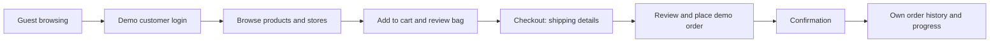
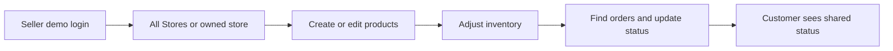
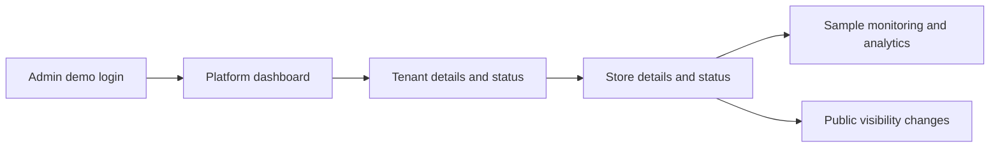

# User flows

[Documentation index](../README.md)

## Customer shopping

Guests can search and filter without a session. Clicking Add to Cart redirects a guest to login with the product as the intended destination. The cart stays empty. Select a customer account, return to the product, and press Add to Cart again. Login through the toolbar instead opens the role home unless a safe destination is supplied.

At `/cart`, change quantities or remove items. Availability and stock are rechecked as shared records change. Checkout collects fictional contact and shipping information, then shows a review step. Submitting validates the full cart and creates one order per store/currency, reduces stock and clears the cart. A submission lock and checkout reference prevent duplicate order creation in the local model.

All orders from one checkout share a confirmation reference. History and direct order URLs show only the signed-in customer's records. USD, EUR and ILS totals remain separate; there is no conversion. New orders have zero demo shipping/discount and use demo cash on delivery. No payment is collected. The timeline shows current status without shipment timestamps, delivery estimates or tracking numbers.

## Seller operations

Choose the seller associated with the required tenant. The store switcher selects All Stores or one owned store. All Stores aggregates only that tenant. The Stores page also allows store creation. Products support validation, active status, price, currency, SKU and stock. Existing products cannot move between stores; create another product instead.

Inventory classifies zero stock as out, 1–5 as low and more than 5 as in stock. Changes update public browsing and cart availability immediately. Sales exclude pending, cancelled and refunded orders and stay grouped by currency.

Allowed order transitions are `pending → paid/cancelled`, `paid → fulfilled/refunded`, `fulfilled → shipped/refunded`, `shipped → delivered`, and `delivered → refunded`. Cancelled and refunded are terminal. These are demo workflow changes, not payment or shipping provider actions.

## Platform administration

Admin sees all tenants and stores, can inspect records and confirm suspension/reactivation, and can filter analytics and sample monitoring events. Monitoring is deterministic seed data; actions do not create live telemetry. Suspending a tenant hides all its public stores/products; suspending one store hides that storefront/products. Reactivation restores visibility only when the product, store and tenant all meet public visibility rules.

## Cross-role demonstration

1. As a customer, place an order and note its number and store.
2. Sign out, then sign in as the seller for that store's tenant. Choose the store or All Stores, find the order and advance its status.
3. Sign out and select the original customer. Open history/details to see the new status.
4. Sign out and choose Platform Admin Demo. Suspend the store after confirmation; browse publicly to verify it disappears. Existing customer orders remain available.
5. Restore the store, then reload to check persistence.

Sign-out clears the cart and selections, but retains orders and edits. All role changes above use the same browser origin and saved graph. Use Reset Demo Data after the demonstration if a clean seed is needed; confirmation removes created orders and profiles while retaining the theme.
